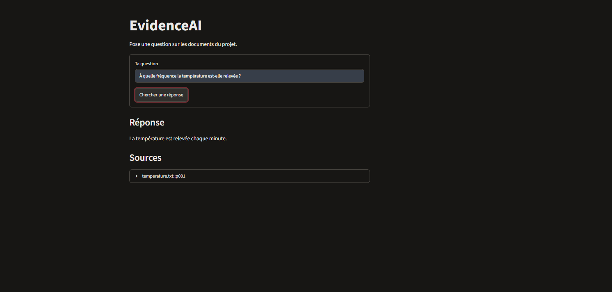
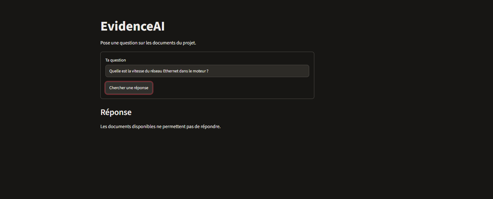
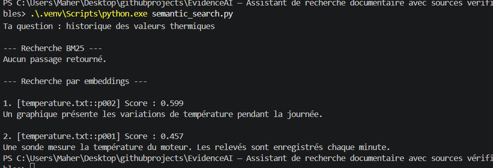
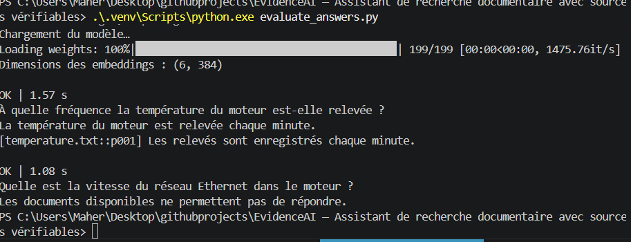

# EvidenceAI

EvidenceAI répond à des questions sur un corpus documentaire et affiche les extraits cités. Quand les passages sélectionnés ne permettent pas de répondre, l’assistant s’abstient.

La démo utilise trois documents techniques fictifs découpés en six passages. Elle combine **BM25** et **MiniLM multilingue** avec la fusion de rangs **RRF**. Groq génère la réponse et le programme vérifie que chaque extrait cité figure mot pour mot dans le passage indiqué.

## Démonstration

### Réponse avec source



La source s’ouvre dans Streamlit pour afficher l’extrait d’origine.

### Abstention



Le corpus ne donne pas la vitesse du réseau Ethernet. L’assistant affiche un message d’abstention.

## Installation sous Windows

Depuis la racine du dépôt, dans PowerShell.

```powershell
python -m venv .venv
.\.venv\Scripts\python.exe -m pip install torch --index-url https://download.pytorch.org/whl/cpu
.\.venv\Scripts\python.exe -m pip install numpy rank_bm25 sentence-transformers groq pydantic python-dotenv streamlit
```

Créer un fichier `.env` à la racine du projet avec une clé obtenue dans la [console Groq](https://console.groq.com/keys).

```dotenv
GROQ_API_KEY=remplacer_par_sa_cle
GROQ_MODEL=openai/gpt-oss-20b
```

Le fichier `.env` est exclu de Git. MiniLM est téléchargé au premier lancement et la recherche s’exécute sur le processeur. La question et les passages sélectionnés sont envoyés à Groq pour générer la réponse.

## Lancer l’application

```powershell
.\.venv\Scripts\python.exe -m streamlit run app.py --server.port 8503
```

Ouvrir [EvidenceAI](http://localhost:8503) et poser une question sur les documents du projet.

## Évaluation

```powershell
.\.venv\Scripts\python.exe evaluate_search.py
.\.venv\Scripts\python.exe evaluate_answers.py
```

`evaluate_search.py` compare BM25, MiniLM et RRF avec les résultats Top 1, Top 3 et le temps moyen de recherche. Pour « historique des valeurs thermiques », la capture ci-dessous montre que MiniLM retrouve un passage sur la température, tandis que BM25 ne retourne aucun passage.



`evaluate_answers.py` vérifie une réponse avec citation et un cas d’abstention. Sur l’exécution capturée, les deux contrôles passent en **1,57 s** et **1,08 s** respectivement.



Ces mesures illustrent une exécution sur le corpus de démonstration. Le contrôle automatique vérifie la présence de l’extrait dans le texte source. La lecture de la citation permet de vérifier qu’elle justifie la réponse.
